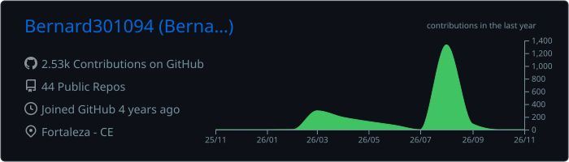
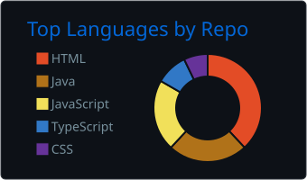

---

## Sobre mim

Sou desenvolvedor de software, venezuelano, morando em Fortaleza (CE), e estudante de **Análise e Desenvolvimento de Sistemas**.

Aprendo construindo: pego um problema real, entendo o contexto e entrego uma solução que funcione no dia a dia de quem usa. Hoje estou me aprofundando em **Java, Android, backend e bancos de dados**, com atenção a arquitetura, testes, segurança e experiência do usuário.

| | |
|---|---|
| **Foco atual** | Java · Android · Backend · SQL |
| **Também trabalho com** | React · TypeScript · Vitest · Playwright |
| **Formação** | Análise e Desenvolvimento de Sistemas |
| **Idiomas** | Espanhol (nativo) · Português (fluente) · Inglês (pré-intermediário) |

---

## Projetos em destaque

<table>
<tr>
<td width="50%" valign="top">

### ☕ PontoCafe
Controle de pausas de café com reconhecimento facial, perfis de acesso e modo terminal de ponto.

`Android` `Java` `Reconhecimento facial` `Autenticação`

</td>
<td width="50%" valign="top">

### 🌿 FloraCareAI
Identificação e acompanhamento de plantas com IA, dados climáticos e recomendações de rega adaptativas.

`Android` `IA` `APIs` `Dados climáticos`

</td>
</tr>
<tr>
<td width="50%" valign="top">

### 📊 Gestão de Absenteísmo
Acompanhamento de efetivo, ausências e distribuição operacional de colaboradores, com indicadores para a gestão.

`Web` `Regras de negócio` `Indicadores`

</td>
<td width="50%" valign="top">

### 🧪 Laboratório
Estudos de arquitetura, APIs REST, SQL, automação e IA aplicada, em projetos menores.

`Java` `APIs REST` `SQL` `Automação`

</td>
</tr>
</table>

---

## Tecnologias

  

  

  
  

---

## Como eu desenvolvo

**Problema → Análise → Implementação → Testes → Refatoração → Evolução**

Antes de escolher uma tecnologia, procuro entender o problema. Escrevo o teste antes do código quando possível, mantenho as mudanças pequenas e revisáveis e cuido do que vem depois da entrega: tratamento de erros, segurança e manutenção.

---

## Atividade no GitHub

<picture>
  <source media="(prefers-color-scheme: dark)" srcset="https://raw.githubusercontent.com/Bernard301094/Bernard301094/output/github-snake-dark.svg" />
  
</picture>

Atualizado diariamente via GitHub Actions.

---

**Aberto a oportunidades, colaboração e troca de conhecimento.**

