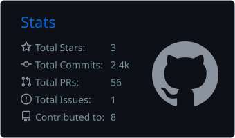

 

---

### ⚡ Agora

<table>
<tr>
<td align="center" width="25%">🔨 <b>Construindo</b> apps que resolvem problemas reais</td>
<td align="center" width="25%">📚 <b>Estudando</b> Análise e Desenvolvimento de Sistemas</td>
<td align="center" width="25%">🎯 <b>Foco</b> Java · Android · Backend · SQL</td>
<td align="center" width="25%">🌎 <b>Falo</b> Español · Português · English (aprendendo)</td>
</tr>
</table>

Venezuelano 🇻🇪 morando em Fortaleza 🇧🇷. Meu jeito de aprender é simples: **pego um problema de verdade e construo a solução**. No caminho, cuido de testes, segurança e de quem vai usar.

---

### 🚀 Projetos

<table>
<tr>
<td width="50%" valign="top">

#### ☕ PontoCafe
Pausas de café com **reconhecimento facial**, perfis de acesso e modo terminal de ponto.

[**→ Ver projeto**](https://github.com/Bernard301094/PontoCafe)

</td>
<td width="50%" valign="top">

#### 🌿 FloraCareAI
Cuida das suas plantas com **IA e dados do clima**: identifica a espécie e diz quando regar.

[**→ Ver projeto**](https://github.com/Bernard301094/FloraCareAI)

</td>
</tr>
<tr>
<td width="50%" valign="top">

#### 📊 Gestão de Absenteísmo
Efetivo, ausências e distribuição de equipes **num painel só**, com indicadores para a gestão.

[**→ Ver projeto**](https://github.com/Bernard301094/Gestao-Absenteismo-Vonixx)

</td>
<td width="50%" valign="top">

#### 🧪 Laboratório
Onde testo arquitetura, **APIs REST**, SQL, automação e IA em projetos menores.

[**→ Todos os repositórios**](https://github.com/Bernard301094?tab=repositories)

</td>
</tr>
</table>

---

### 🛠️ Minha caixa de ferramentas

  
   
  

---

### 📈 Atividade

<picture>
  <source media="(prefers-color-scheme: dark)" srcset="https://raw.githubusercontent.com/Bernard301094/Bernard301094/output/github-snake-dark.svg" />
  
</picture>

---

### 🎲 Curiosidades

- 🧠 Gosto de entender o **porquê** antes de escrever o código
- ✅ Escrevo o teste **antes** e mantenho os PRs pequenos
- ☕ Fiz um app só pra organizar as pausas de café

---

**Bora trocar uma ideia? Estou aberto a oportunidades e colaborações** 💬

